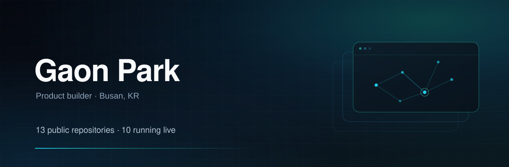

  

### 박가온 · Gaon Park

Browser tools for paperwork. Static pages, no server, no account, no upload.

- **FIN 다음** (Team FINdaum), co-founder
- **부산대학교 정치외교학과**, Pusan National University
- 前 **국회 보좌진**
- **KAMCO** 채권기획팀
- **행정안전부 장관표창**, 2030 청년정책자문단 디지털정부 분과 (2025)
- **Beyond Busan** 운영, 2기 · 3기

#### Live

| Project | What it does | Demo |
|:--------|:-------------|:-----|
| **[shortfall](https://github.com/qkrrkdhzdl-arch/shortfall)** | Weekly hours and overtime pay under the Korean Labor Standards Act and the US FLSA, checked against the payslip. | [demo](https://qkrrkdhzdl-arch.github.io/shortfall/) |
| **[blot](https://github.com/qkrrkdhzdl-arch/blot)** | Finds personal data in a document, verifies numbers by check digit, and reports what still re-identifies after masking. | [demo](https://qkrrkdhzdl-arch.github.io/blot/) |
| **[hwp-reader](https://github.com/qkrrkdhzdl-arch/hwp-reader)** | Opens Korean HWP 5.0 documents in the browser. OLE2/CFB container and record streams parsed on the device. | [demo](https://qkrrkdhzdl-arch.github.io/hwp-reader/) |
| **[noticeline](https://github.com/qkrrkdhzdl-arch/noticeline)** | Turns a grant notice into an eligibility check, a document checklist and a D-day plan. | [demo](https://qkrrkdhzdl-arch.github.io/noticeline/) |
| **[packetproof](https://github.com/qkrrkdhzdl-arch/packetproof)** | Pre-flight check for a submission packet: missing files, wrong formats, duplicates, ID numbers. Seals a SHA-256 receipt. | [demo](https://qkrrkdhzdl-arch.github.io/packetproof/) |
| **[clausedrift](https://github.com/qkrrkdhzdl-arch/clausedrift)** | Compares two versions of a contract clause by clause and puts the money side by side. | [demo](https://qkrrkdhzdl-arch.github.io/clausedrift/) |
| **[second-read](https://github.com/qkrrkdhzdl-arch/second-read)** | Marks the part of a suspicious Korean or English message that is doing the work. Runs offline. | [demo](https://qkrrkdhzdl-arch.github.io/second-read/) |
| **[fieldlog](https://github.com/qkrrkdhzdl-arch/fieldlog)** | Offline-first construction safety log. Gemini Nano on the device, Gemini Flash when the device cannot run it. | [demo](https://qkrrkdhzdl-arch.github.io/fieldlog/) |
| **[morrow](https://github.com/qkrrkdhzdl-arch/morrow)** | Deadline and artifact graph instead of a to-do list, on Neo4j WASM and OPFS. | [demo](https://qkrrkdhzdl-arch.github.io/morrow/) |
| **[fearless-ledger](https://github.com/qkrrkdhzdl-arch/fearless-ledger)** | Fearless Draft room for professional League of Legends, built on 801 LCK/LPL/LEC/LCS/Worlds games. | [demo](https://qkrrkdhzdl-arch.github.io/fearless-ledger/) |

#### Source only

| Project | What it does |
|:--------|:-------------|
| **[clearlot](https://github.com/qkrrkdhzdl-arch/clearlot)** | Colour grading for returnable glass crates with a hash-chained handoff receipt. Python, FastAPI. |
| **[ple-measured-twice](https://github.com/qkrrkdhzdl-arch/ple-measured-twice)** | Submission tooling for Kaggle Physical-Engineering's Last Exam. Python. |

부산 · KST · 공개한 코드는 리포지토리에 별도 표기가 없으면 MIT입니다.
